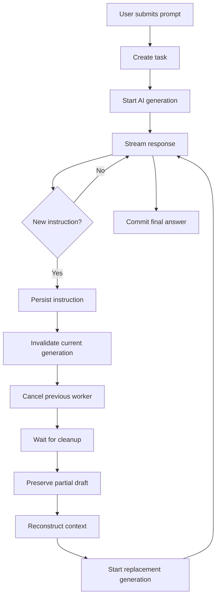
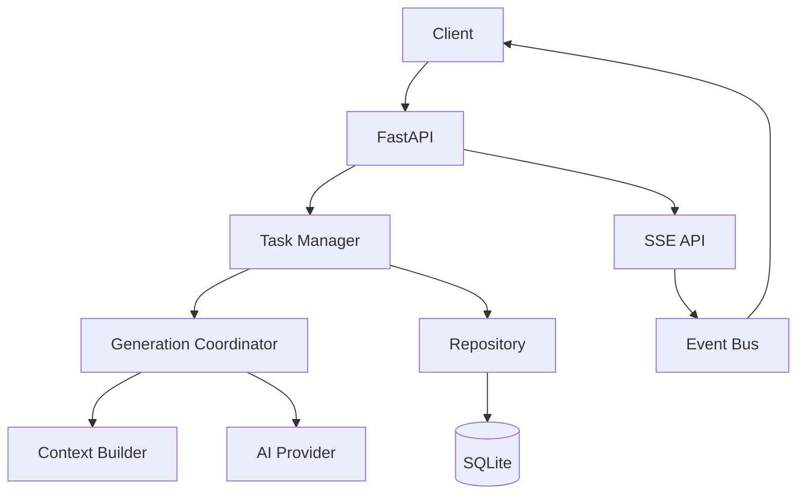

# PromptFlow

### Think while AI thinks.

**PromptFlow** is an educational project that explores live instruction injection during AI response generation.

It allows users to submit new instructions while an AI response is streaming. Instead of modifying an in-flight model request, PromptFlow safely cancels the existing generation, preserves its partial draft, reconstructs the context, and starts a replacement generation.

## Current Status

<sub>Version: `0.3.0`</sub>

| Phase | Implementation | Status |
|---|---|---|
| 1 | Database, persistence, state management, recovery | Complete |
| 2 | AI generation pipeline, mock provider, SSE streaming | Complete |
| 3 | Live instructions, cancellation, replacement, manual stop | Complete |
| 4 | Browser interface | Planned |
| 5 | Real AI provider integration | Planned |
| 6 | Hardening and extended testing | Planned |

**130 automated offline tests passing.**

## Key Features

- **Live Instructions:** Submit instructions while generation is running.
- **Instruction Classification:** Classifies instructions as `ADDITION`, `MODIFY`, `CORRECTION`, `RESTRICTION`, `REFOCUS`, or `NEW_TASK`.
- **Debounced Regeneration:** Groups rapid instructions into one replacement generation.
- **Safe Cancellation:** Waits for the previous worker and provider cleanup before restarting.
- **Context Reconstruction:** Uses the original prompt, ordered instructions, classifications, and previous partial draft.
- **Draft Preservation:** Maintains the last successful answer separately from the current working draft.
- **Generation Fencing:** Prevents outdated workers from modifying newer task state.
- **Manual Stop:** Stops generation safely while preserving partial output.
- **Real-Time Streaming:** Uses Server-Sent Events (SSE).
- **Persistent Storage:** Stores tasks, instructions, generations, and durable events in SQLite.
- **Startup Recovery:** Reconciles interrupted tasks after application restart.
- **Deterministic Testing:** Uses asynchronous event barriers to test concurrency and cancellation.

## How It Works



## Architecture



| Component | Responsibility |
|---|---|
| FastAPI | HTTP API and application lifecycle |
| Task Manager | Task operations and snapshots |
| Generation Coordinator | Workers, cancellation, debounce, replacement, stop |
| Context Builder | Reconstructs generation context |
| Instruction Classifier | Deterministic instruction classification |
| Repository | Database operations and generation fencing |
| Event Bus | SSE subscribers and overflow recovery |
| Mock Provider | Deterministic asynchronous streaming |

## Technology Stack

| Category | Technologies |
|---|---|
| Language | Python |
| Backend | FastAPI, Pydantic |
| Concurrency | asyncio |
| Database | SQLite, aiosqlite |
| Streaming | Server-Sent Events |
| Configuration | pydantic-settings, `.env` |
| Testing | pytest, AnyIO, HTTPX |
| Server | Uvicorn |

## Requirements

- Python 3.11 or newer
- SQLite (included with Python)
- No API key required for the default mock provider

Verified with Python **3.14.7**.

## Getting Started

### Windows (PowerShell)

```powershell
python -m venv .venv

.\.venv\Scripts\python.exe -m pip install -r requirements.txt

Copy-Item .env.example .env

.\.venv\Scripts\python.exe -m uvicorn app.main:app --reload
```

### macOS / Linux

```bash
python3 -m venv .venv

./.venv/bin/python -m pip install -r requirements.txt

cp .env.example .env

./.venv/bin/python -m uvicorn app.main:app --reload
```

### Verify Installation

| Endpoint | URL |
|---|---|
| Health Check | http://127.0.0.1:8000/api/health |
| API Documentation | http://127.0.0.1:8000/docs |

Expected health response:

```json
{
  "status": "ok",
  "database": "ok",
  "provider": "mock",
  "version": "0.3.0"
}
```

SQLite database files are created automatically under `data/`.

## Configuration

Configure the application through environment variables or `.env`.

| Variable | Default | Description |
|---|---|---|
| `AI_PROVIDER` | `mock` | Provider selection |
| `OPENAI_API_KEY` | Empty | Reserved for future provider integration |
| `OPENAI_MODEL` | Empty | Reserved model configuration |
| `MOCK_STREAM_DELAY_MS` | `40` | Delay between mock chunks |
| `MOCK_STREAM_CHUNK_CHARS` | `24` | Characters per mock chunk |
| `MOCK_INITIAL_DELAY_MS` | `0` | Initial streaming delay |
| `MOCK_FAILURE_AFTER_CHUNKS` | Empty | Optional mock failure point |
| `DATABASE_PATH` | `./data/promptflow.db` | SQLite database location |
| `INSTRUCTION_DEBOUNCE_MS` | `250` | Instruction debounce window |
| `CHECKPOINT_INTERVAL_MS` | `500` | Draft checkpoint interval |
| `MAX_PROMPT_CHARS` | `12000` | Maximum prompt length |
| `MAX_INSTRUCTION_CHARS` | `6000` | Maximum instruction length |
| `MAX_INSTRUCTIONS_PER_TASK` | `100` | Maximum instructions per task |
| `PROVIDER_TIMEOUT_SECONDS` | `120` | Provider timeout |
| `CANCELLATION_TIMEOUT_SECONDS` | `5` | Cancellation cleanup timeout |
| `SSE_QUEUE_SIZE` | `256` | Per-subscriber event queue size |
| `SSE_HEARTBEAT_SECONDS` | `15` | SSE heartbeat interval |

**Note:** The real OpenAI provider is not implemented yet. Keep `AI_PROVIDER=mock`.

## API Reference

| Method | Endpoint | Description |
|---|---|---|
| `GET` | `/api/health` | Application and database health |
| `POST` | `/api/tasks` | Create a task and start generation |
| `GET` | `/api/tasks/{task_id}` | Retrieve task snapshot |
| `POST` | `/api/tasks/{task_id}/instructions` | Submit a live instruction |
| `POST` | `/api/tasks/{task_id}/stop` | Stop an active generation |
| `GET` | `/api/tasks/{task_id}/events` | Subscribe to SSE events |

### Create a Task

```http
POST /api/tasks
Content-Type: application/json
```

```json
{
  "prompt": "Explain event loops in one paragraph."
}
```

### Submit a Live Instruction

```http
POST /api/tasks/{task_id}/instructions
Content-Type: application/json
```

```json
{
  "content": "Explain it using simple English.",
  "client_instruction_id": "ui-1"
}
```

Use `client_instruction_id` to make retries idempotent.

### Stop Generation

```http
POST /api/tasks/{task_id}/stop
```

A stop request returns `CANCELLING`. The task becomes `STOPPED` only after cleanup finishes.

### Instruction Classification

| Type | Meaning |
|---|---|
| `ADDITION` | Introduces new requirements |
| `MODIFY` | Changes an existing requirement |
| `CORRECTION` | Corrects information |
| `RESTRICTION` | Adds a limitation |
| `REFOCUS` | Changes the main focus |
| `NEW_TASK` | Requests an unrelated task |

Classification is deterministic metadata. It does not rewrite or discard the user's instruction.

`NEW_TASK` is persisted and returned with `requires_new_task: true`. It does not silently replace the existing task.

## SSE Events

The SSE endpoint provides real-time updates.

| Event | Purpose |
|---|---|
| `snapshot` | Initial task state |
| `generation_started` | Generation begins |
| `token_delta` | New response text |
| `checkpoint` | Draft checkpoint |
| `instruction_accepted` | Instruction persisted |
| `generation_invalidated` | Previous generation invalidated |
| `draft_preserved` | Partial draft retained |
| `context_updated` | Replacement context prepared |
| `generation_restarted` | Replacement generation created |
| `generation_completed` | Final answer committed |
| `generation_cancelled` | Generation cancelled |
| `task_stopped` | Task stopped |
| `resync_required` | Client should fetch a fresh snapshot |

### Replacement Event Sequence

```text
instruction_accepted
        |
generation_invalidated
        |
draft_preserved
        |
context_updated
        |
generation_restarted
        |
generation_started
        |
token_delta / checkpoint
        |
generation_completed
```

SSE uses snapshot-based recovery. Token deltas and checkpoints are not persisted for replay.

## Engineering Guarantees

- **Version Fencing:** Every generation has a version. Stale generations cannot overwrite newer state.
- **Single Worker:** Only one active generation worker per task.
- **Safe Replacement:** A replacement waits for previous worker cleanup.
- **Atomic Persistence:** Database transactions protect instruction acceptance, checkpoints, and terminal state changes.
- **Draft Integrity:** Cancelled or failed generations do not destroy the last committed answer.
- **Idempotency:** Duplicate instructions and stop requests are handled safely.
- **Bounded SSE Queues:** Slow subscribers trigger resynchronization instead of unbounded memory growth.
- **Disconnect Safety:** Disconnecting an SSE client does not cancel generation.
- **Startup Recovery:** Active tasks are reconciled from SQLite before serving traffic.
- **Deterministic Tests:** Concurrency tests use `asyncio.Event` barriers rather than arbitrary sleeps.

## Project Structure

```text
app/
├── main.py
├── config.py
├── api/
│   ├── health.py
│   ├── tasks.py
│   └── events.py
├── core/
│   ├── state.py
│   ├── errors.py
│   ├── clock.py
│   ├── event_types.py
│   ├── event_bus.py
│   ├── task_manager.py
│   ├── generation_coordinator.py
│   ├── context_builder.py
│   └── instruction_classifier.py
├── services/
│   ├── ai_provider.py
│   ├── mock_provider.py
│   └── factory.py
├── database/
│   ├── connection.py
│   ├── migrations.py
│   ├── schema.sql
│   ├── records.py
│   └── repository.py
└── schemas/
    └── task.py

tests/
├── unit/
├── api/
└── integration/

docs/
├── architecture.md
├── live-instruction-flow.md
└── testing.md

.env.example
.gitignore
requirements.txt
README.md
```

## Running Tests

```powershell
.\.venv\Scripts\python.exe -m pytest
```

Additional verification:

```powershell
.\.venv\Scripts\python.exe -m compileall -q app tests
```

**Test coverage includes:**

- State transitions and validation
- Database migrations and recovery
- Generation and streaming
- Instruction classification
- Cancellation and replacement
- Debouncing and idempotency
- Manual stop and race conditions
- SSE ordering and queue overflow

All tests run offline using the deterministic mock provider.

See:
- `docs/testing.md`
- `docs/architecture.md`
- `docs/live-instruction-flow.md`

## Known Limitations

- Single-process architecture; do not run multiple Uvicorn workers.
- SQLite is intended for this local project, not horizontal scaling.
- No authentication or multi-tenancy.
- No browser interface yet.
- No real AI provider integration yet.
- No `Last-Event-ID` replay; reconnect using the task snapshot.
- Instruction classification uses deterministic heuristics, not an LLM.
- Provider cancellation is cooperative. A cleanup timeout leaves the task in `CANCELLING` and prevents replacement until cleanup finishes.
- Failed replacements are not restarted automatically.
- SQLite files stored in OneDrive may experience synchronization-related locking issues. Use a local, non-synced `DATABASE_PATH` if needed.

## Roadmap

- [x] Phase 1 — Persistence and state management
- [x] Phase 2 — Generation pipeline and SSE streaming
- [x] Phase 3 — Live instruction replacement and safe cancellation
- [ ] Phase 4 — Browser-based interface
- [ ] Phase 5 — Optional OpenAI Responses API integration
- [ ] Phase 6 — Hardening and extended testing
